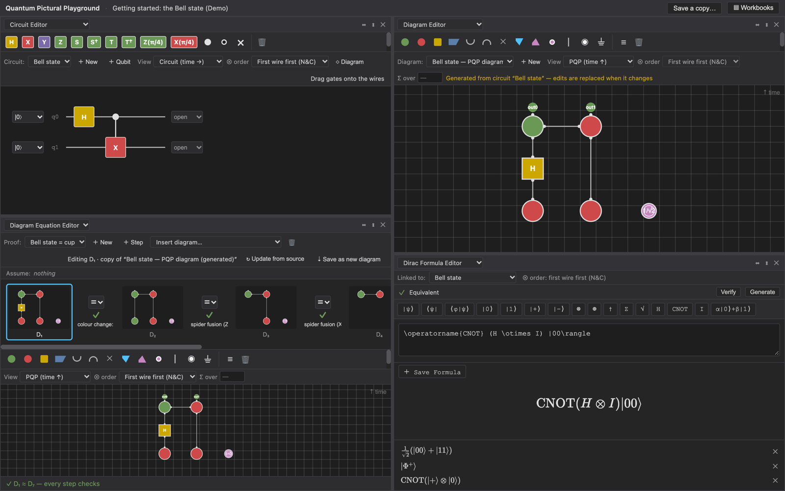
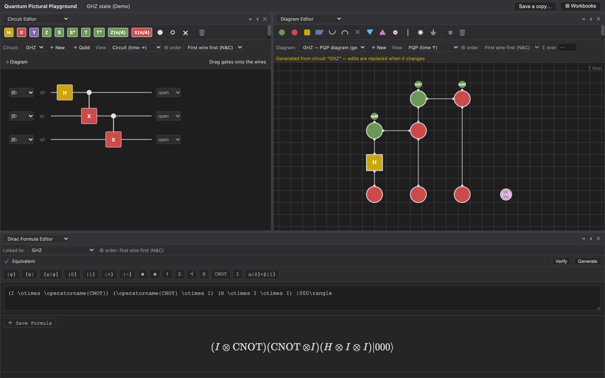
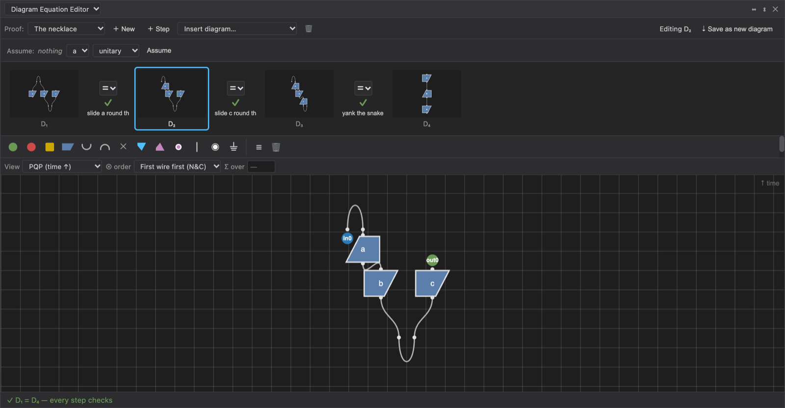
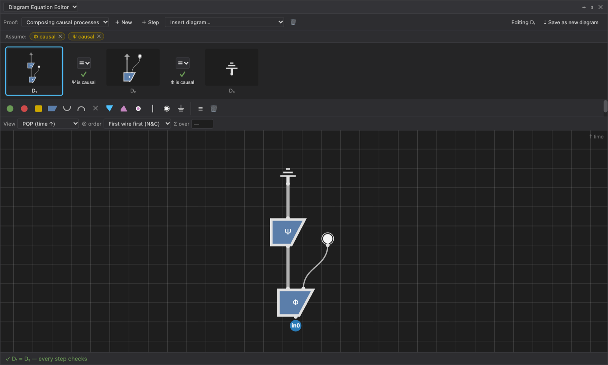

# Quantum Pictural Playground

A browser-based teaching tool for quantum pictorial diagrams and Dirac
notation, following Coecke & Kissinger's
[*Picturing Quantum Processes*](https://www.cambridge.org/core/books/picturing-quantum-processes/1119568B3101F3A685BE832FEEC53E52).
Features a **drag-and-drop diagram editor** and a **Dirac formula editor**
with **bidirectional synchronisation**: diagrams generate Dirac expressions,
and student-written expressions are verified against diagrams.



The default layout shows a **Circuit Editor** and a **Diagram Editor** side by side above a **Dirac editor**.
The interface uses a **Blender-style split-panel layout** where every panel
can be split, merged, resized, and assigned an arbitrary editor type.

---

## Features

### Workbooks
- **A workbook** is what you save: its circuits, diagrams and proofs, the links between them, and the panel layout (with each panel's state)
- **Workbook Browser** — **Demos** (shipped with the app, read-only) and **My Workbooks** in one tree; open, save, save a copy, rename, delete
- **Demos** open with their own layout; edit freely, then **Save a copy** to keep your changes
- **My Workbooks** are saved on the server (MongoDB, `backend/`) when it is running, and in this browser otherwise. Saves from a stale tab are refused rather than overwriting newer work

### Circuit Editor
- **Quirk-style circuits** — drag gates onto wires; controls, anti-controls, swaps, phase gates
- **Live PQP diagram** — each circuit keeps a generated ZX-style diagram (CNOT = spiders joined by a horizontal leg)
- **Dirac** — written step by step, e.g. `CNOT (H ⊗ I)|00⟩`, and verified like any diagram
- **Measurement** — the meter measures a qubit; from then on its wire is classical (a double line), and only controls may sit on it, making their step classically controlled. Outputs can be discarded (⏚). A measuring circuit is a quantum process, so its PQP diagram is **doubled**: thick quantum wires, thin classical ones, white dots for measurements and classical controls — enough for teleportation, which the checker confirms is exactly a wire



### Diagram Equation Editor
- **Diagrammatic proofs** — D₁ ≈ D₂ = D₃ …, each step a copy of a diagram (never a live link)
- **＋ Step** duplicates the selected step (the usual way to make the next one); **Insert diagram…** copies in any diagram or a circuit's diagram
- **Every step checked** against the previous one, live: `=` exactly, `≈` up to a nonzero scalar
- **Symbolic diagrams** (boxes f, states ψ, phases α, α+β, 2α−π/2 …) checked by random substitution — a pass is overwhelming evidence, a fail is a definite counterexample
- **Assumptions** — "for causal Φ", "U unitary", "V an isometry": the checker samples values satisfying them (causality is linear, so a random causal map is a random point of exactly that set)
- **Sums** Σᵢ over a basis, drawn as in PQP
- **One-click rewrites** — select spiders (or Hadamards) and the inspector offers the rules that apply: **spider fusion**, **remove identity**, **H·H**, **colour change** (and back), **π-copy**, **copy a basis state**, **complementarity**. In a proof the result becomes the next step, noted with the rule. Each is checked before it is kept; scalars are exact (added as a scalar node, so the step is `=`) when the diagram is numeric, and `≈` when symbols make the scalar unknown
- **Rewrite by copy and paste** — ＋ Step, select the region to rewrite, Cmd+V the replacement (from any diagram or step): wires reconnect in order, and the step is checked

<table><tr>
<td></td>
<td></td>
</tr><tr>
<td align="center"><em>Sliding boxes round bends (Prop. 4.30)</em></td>
<td align="center"><em>Causal processes compose (thick wires, ⏚, assumptions)</em></td>
</tr></table>

### Diagram Editor
- **PQP shapes** — boxes with a slanted side and states/effects with a clipped corner, so f, fᵀ, f† and f̄ are drawn (and computed) distinctly: one symbol, transformed
- **Sliding** — a box slides round a cup or cap and comes out as its transpose, as a single undoable rewrite
- **Pulling taut** (PQP §4: wires are string, only connectivity matters) — snakes vanish, crossings go, and the boxes riding a wire slide along it into a column; any that went round a bend come out transposed. An animated preview shows the string tightening and the boxes turning as they go round, with a scrubber, then **Apply**. Every result is checked equal to the original first
- **The doubled picture** (PQP ch. 6–8) — thick quantum wires and thin classical ones; doubled generators, general processes, white dots (copy, delete, measure, encode, decoherence) and discard ⏚; strict PQP typing (thin wires in a doubled diagram are classical, so a thin phase spider there is flagged in red); fully checkable in proofs
- **10 generator types** from ZX-calculus / categorical quantum mechanics:
  Z Spider, X Spider, Hadamard, Morphism box, Cup (η), Cap (ε), Swap (σ),
  State (ψ), Effect, Scalar
- **Bottom-to-top flow** (PQP convention): inputs from below, outputs above.
  "↑ time" indicator in the canvas corner.
- **No tool modes** — drag port handles to wire, drag nodes to move, 🗑 deletes the selection. Pan (Alt+drag), Zoom (scroll).
- **Inspector** — edit the selected node's label/phase and its number of input/output legs
- **Spider legs** — wires between two spiders are legs (direction-free, by flexsymmetry): drawn straight between the dots, added on demand, and removed together with the wire
- **Phase/label editing** — double-click any node
- **Palette sidebar**, **multiple diagrams**, **undo/redo** (Cmd/Ctrl+Z)
- **Boundary markers** — numbered "in/out" labels on open ports

### Dirac Formula Editor
- LaTeX textarea with **live KaTeX rendering** and snippet buttons
- **Linked to diagrams** — dropdown selector for which diagram to sync with
- **Generate** — diagram → Dirac expression (per-component, with recognition)
- **Verify** — student expression vs diagram: ✓ Equivalent / ✗ Not equivalent
- **Never overwrites student work** — generated forms shown as suggestions
- **Quantum processes in two notations, side by side** — a doubled diagram (or a circuit that measures) is written both the familiar way, `ρ ↦ Σ K ρ K†` (or, for a state, its density operator), and in PQP's doubled notation, `Σᵢ |i⟩ ⊗ ⟨i|̂` with `\widehat{f}` = f̄ ⊗ f wire by wire. **Write in** chooses which goes in the editor; either is verified. A classical (thin) wire is a diagonal `|i⟩⟨i|` in the familiar form and a single index in PQP's. Every generated expression is checked against the diagram before it is shown; teleportation comes out as `ρ ↦ ρ` and `\widehat{I}`
- **Sums over a basis** — `\sum_{i,j} …` (kets and bras labelled i, j take 0 and 1), for diagrams with a Σ and in processes

### Numbers
- **A Numbers panel** (any panel's editor menu) shows what a circuit, diagram — or the nodes selected in a diagram — is in numbers: its matrix as a colour map (brightness = size, colour = phase; hover a cell for its value), whether it is unitary or causal, the **Born-rule probabilities** of a state as bars, its **density operator** in the doubled picture (and the probabilities of its classical outcomes), and a **Bloch sphere** for one qubit (pure on the surface, mixed inside)

### Linking the views
- **Hover a term** of a generated Dirac expression and the diagram nodes (and circuit step) it comes from light up; hover a node or a gate and its term lights up
- **∘⊗** in the Diagram Editor's bar shows how the diagram reads as a formula: layers composed in sequence (∘, bottom to top) and pieces side by side (⊗)

### Diagram → Dirac Translation
- **Component decomposition** — disconnected pieces translated independently
- **Named-object recognition** — CNOT, CZ, SWAP, H, X, Y, Z, S, T, Bell
  states/effects, computational basis (up to scalar)
- **Pedagogical classification** (Categories A–G)
- **Scalar folding** — cancelling scalars simplified away
- **Tensor contraction** — pairwise tensor-network contraction (greedy order); wire order follows port positions, left to right

### Verification
- Shape-aware; phase vs scalar distinction; pedagogical hints on disagreement

### Layout Engine
- Split / merge / resize panels; switch editor type per-panel

---

## Getting Started

No build step required — pure vanilla ES modules + one CDN dependency (KaTeX).
The frontend and backend are independent: deploy them separately.

**Frontend** (`frontend/`): static files. Copy the folder's contents to any
web directory (e.g. a subfolder of `public_html`) and serve them with any HTTP
server; every path in the app is relative. For local work, serve `frontend/`
with your own server, e.g. `cd frontend && python3 -m http.server 8000`, and
open **http://localhost:8000**. It must be served over HTTP (not `file://`).

Set where the backend is in **`frontend/config.js`** (`apiBase`). With no
backend, My Workbooks is kept in the visitor's browser; on `localhost` the app
tries `http://localhost:8080/api` by default.

**Backend** (`backend/`, optional): a JSON API only (Express + MongoDB), called
by the frontend across origins. See [backend/README.md](backend/README.md).

```bash
cd backend
npm install
ALLOWED_ORIGINS=http://localhost:8000 npm start   # API on http://localhost:8080/api
```

Tests: open `tests/test-fixtures.html` from the served frontend; the backend's
with `cd backend && npm test`.

---

## Architecture

```
frontend/                 # the app: static files, no build step
  index.html, css/, js/   #   (js/ below)
  demos/                  #   Demo workbooks (JSON, generated by tools/build-demos.mjs)
  tests/                  #   browser unit tests (tests/test-fixtures.html)
  tools/                  #   build-demos.mjs
  config.js               #   deployment setting: where the backend's API is
backend/                  # Express + MongoDB JSON API (users, workbooks); deployed separately
docs/                     # design notes and README images
```

```
js/
├── app.js                            # Boot: register editors, app bar, open the Getting started demo
├── workbooks/
│   ├── Workbook.js                   # Workbook format: capture / open (documents + layout)
│   ├── WorkbookStores.js             # Demos (read-only), My Workbooks (browser storage; server stub)
│   └── WorkbookSession.js            # The open workbook, unsaved changes, save / save a copy
├── core/                             # Sync engine (pure computation, no DOM)
│   ├── FlowDirection.js              # Single source of truth for diagram convention
│   ├── Complex.js                    # Complex arithmetic as [re,im] pairs
│   ├── Tensor.js                     # Dense complex matrices: mul, kron, trace, etc.
│   ├── Phase.js                      # Rational π-multiple phases
│   ├── IR.js                         # Internal representation: typed open graph
│   ├── DiagramToIR.js                # Diagram → IR adapter + well-formedness checks
│   ├── ContractIR.js                 # Tensor network contraction
│   ├── Interpret.js                  # Generator → tensor (spiders, cups, caps, etc.)
│   ├── KnownGates.js                 # Recognition library (CNOT, H, Bell, etc.)
│   ├── Classify.js                   # Pedagogical classifier (Categories A–G)
│   ├── DiagramToDirac.js             # Diagram → Dirac LaTeX (component decomposition)
│   ├── DiracParser.js                # LaTeX → AST (recursive descent)
│   ├── DiracEval.js                  # AST → Tensor
│   ├── CircuitGates.js               # Gate library, column operators, reference simulator
│   ├── CircuitToIR.js                # Circuit → ZX-style IR (exact, scalars included)
│   ├── CircuitToDirac.js             # Circuit → Dirac, column by column
│   ├── ProofCheck.js                 # Step checks (= / ≈), random substitution for symbols
│   ├── Verify.js                     # Tensor comparison with pedagogical hints
│   ├── SyncController.js             # Sync state machine (stale/equivalent/etc.)
│   └── Config.js                     # Thresholds and settings
├── editors/
│   ├── EditorRegistry.js             # Pluggable editor type registry
│   ├── DocumentStore.js              # Registry of all documents (diagrams + circuits)
│   ├── DiagramEditor/                # Canvas-based diagram editor
│   │   ├── DiagramEditor.js          # Toolbar + doc selector + canvas + palette
│   │   ├── DiagramCanvas.js          # Interactive canvas + boundary markers
│   │   ├── DiagramNode.js            # 10 generator types + rendering
│   │   ├── DiagramWire.js            # Bézier wires + hit-testing
│   │   ├── DiagramToolbar.js         # Tool & node-add buttons
│   │   └── DiagramDocument.js        # Shared data model + undo/redo + observer
│   ├── WorkbookBrowser/
│   │   └── WorkbookBrowser.js        # Demos + My Workbooks tree, details, open/save
│   ├── EquationEditor/
│   │   ├── EquationEditor.js         # Proof strip + embedded diagram editor
│   │   └── ProofDocument.js          # Steps (owned diagram copies), relations, checks
│   ├── CircuitEditor/
│   │   ├── CircuitEditor.js          # Drag-and-drop circuit editor (no tool modes)
│   │   ├── CircuitDocument.js        # Circuit model (Quirk-style columns) + undo/redo
│   │   ├── IRToDiagram.js            # Lay out a circuit's IR as a PQP diagram
│   │   └── CircuitDiagramLink.js     # Keep a generated diagram in sync with a circuit
│   └── DiracEditor/
│       └── DiracEditor.js            # Textarea + KaTeX + sync bar + Generate/Verify
└── layout/                           # Blender-style split-panel engine
    ├── LayoutManager.js, EditorArea.js, SplitHandle.js
```

### Key Design Patterns

- **Sync hub** — both editors translate into/out of a shared IR (typed open
  graph). They never translate directly into each other.
- **Observer pattern** — `DiagramDocument` fires change events; multiple
  canvases viewing the same document stay in sync automatically.
- **Component decomposition** — disconnected diagram pieces are translated
  independently and combined with ⊗.
- **Pluggable editors** — `EditorRegistry` decouples layout from editor types.
  New editors implement `typeName`, `constructor(el)`, `onResize()`, `destroy()`.

---

## Circuits

`CircuitDocument` models a Quirk-style circuit: qubits × time steps, where a
step's controls (•, ∘) condition every gate in that step and two × cells
swap. Qubit 0 is the leftmost tensor factor (leftmost wire in the diagram).
Inputs can be open or |0⟩, |1⟩, |+⟩, |−⟩; outputs open or post-selected.

- **→ diagram** (ZX style): phase gates become spiders, CNOT/CZ become spiders
  joined by legs, SWAP is a wire crossing, other controlled gates are boxes
  with their exact matrix. Scalars are collected into one scalar node, so the
  diagram equals the circuit exactly.
- **→ Dirac**: one factor per step, latest on the left, e.g.
  `\operatorname{CNOT}(H \otimes I)|00\rangle`; controlled gates in projector form.
- The Dirac editor can link to a circuit and verify against it.

### Circuit Editor

| Action | How |
|---|---|
| Add a gate | Drag it from the palette onto a wire — onto a step, or into the gap between steps to insert a new step (an occupied cell is replaced) |
| Controlled gates | Put • (control) or ∘ (anti-control) in the same step: they condition every gate in that step |
| Swap | Two × in one step |
| Measure | Drag the meter onto a wire. After it the wire is classical (double line): a gate dropped there is refused, but • / ∘ on it classically controls the other gates of its step. A classical wire ends open (read the bit), 0 / 1 (post-select), or ⏚ (delete) |
| Move / remove | Drag a placed gate; drag it off the circuit to remove it |
| Select / delete | Click a gate or a qubit label (q0, q1, …), then 🗑 or **Delete** |
| Phase of Z(θ), X(θ) | Select the gate, type in the inspector's **Phase** field (π/8, −π/2, α, …) |
| Inputs / outputs | Pickers at each end of a wire: open, \|0⟩, \|1⟩, \|+⟩, \|−⟩ (outputs: post-selected effects, or ⏚ discard) |
| Qubits | **＋ Qubit**; select a qubit label + 🗑 to remove |
| View | Circuit (time →) or Algebraic (time ←) |
| Show the diagram | **◇ Diagram** — opens the circuit's PQP diagram in the Diagram Editor and links the Dirac editor |
| Undo / Redo | **Cmd+Z** / **Cmd+Shift+Z** |


---

### Diagram Equation Editor

| Action | How |
|---|---|
| Next step | **＋ Step** — copies the selected step after it; then edit the copy below the strip |
| Bring in a diagram | **Insert diagram…** — diagrams, circuits (their PQP diagram), steps of other proofs; **↻ Update from source** re-copies it |
| Relation | The **= / ≈** menu between two steps |
| Rule used | The **rule…** note under the relation (not checked) |
| Why a step fails | Hover the ✗; the summary bar names the first failing step |
| Select / delete a step | Click it (← → to move); 🗑 or **Delete**; **Cmd+Z** in the strip undoes |
| Assume something about a symbol | The **Assume:** bar above the steps — pick a symbol and **unitary**, **isometry** (normalised, for a state) or **causal**; every check then uses random values satisfying it |
| A sum over a basis (Σᵢ) | In the step's diagram, **Σ over:** `i` — states and effects labelled `i` range over the basis (labels `0`, `1`, `+`, `−` are the basis vectors themselves) |

Symbols are matched by label and shape: the same `f` on both sides of a step is the same map, and a flipped box (fᵀ, f†, f̄ — drawn rotated or reflected) is that same random map, transformed.

---

### Workbooks

| Action | How |
|---|---|
| Browse | **▤ Workbooks** in the app bar (shows the browser in the focused panel; **✕ Close** brings that panel back) |
| Open | Double-click a workbook (or select it and **Open** / **Enter**). Opening replaces all panels; you are asked first if there are unsaved changes |
| Save | **Cmd+S** / **Save** — saves a workbook from My Workbooks in place |
| Keep changes to a demo | **Save a copy…** — saves it to My Workbooks and continues there |
| Rename / delete | **Rename…** (the open workbook); select a workbook in My Workbooks and **🗑 Delete** |

The app bar shows the open workbook, where it is from, and **●** when it has unsaved changes. Closing the tab with unsaved changes asks first.

**Demos:** *Getting started: the Bell state* (the same state as a circuit, its PQP diagram, a proof that it is a cup, and in Dirac notation), *Spider rules*, *Snake equations*, *Sliding round bends* (PQP Prop. 4.30 and the necklace), *Measurement and discarding* (the doubled picture), *Causality* (assumptions and Σᵢ: composing causal maps, measuring is causal), *GHZ state*, *Quantum teleportation* (measurement and classical control; the proof that it is a wire), *Pulling wires taut* (snakes, a box through a snake, the necklace in one pull, crossings that undo, and a tangle to pull yourself).

**Opening a workbook from a link:** `index.html?demo=spider-rules` opens a demo directly; `index.html?open=path/to/workbook.json` opens a workbook file served with the app (the browser tests use `tests/fixtures/classic-workbook.json`).

---

## Reading conventions

Two independent settings:

| Setting | Where | Options | Changes the maths? |
|---|---|---|---|
| **View** — which way time flows | each Diagram Editor panel | PQP (↑), Top-down (↓), Circuit (→), Algebraic (←, as in Wood, Biamonte & Cory: reads like the formula) | No — drawing only |
| **⊗ order** — which wire is the first tensor factor | each document (diagram or circuit) | First wire first (Nielsen & Chuang, PQP) · First wire last (Qiskit, Quirk) | Yes — Dirac output and verification follow it |

Documents are stored in the PQP frame; a view is a rotation/reflection of
it, so changing the view can never change a diagram's meaning. "First wire"
means leftmost in the PQP view (topmost in the Circuit and Algebraic views).
A diagram generated from a circuit takes the circuit's ⊗ order. The Dirac
editor shows the order of the document it is linked to.

---

## Diagram Convention

Diagrams follow the **PQP (bottom-to-top)** convention:

| Element | Role | Ports |
|---|---|---|
| Cup (∪) | State \|Φ⁺⟩ | 2 outputs (top) |
| Cap (∩) | Effect ⟨Φ⁺\| | 2 inputs (bottom) |
| State (▽) | State preparation | 1 output (top) |
| Effect (△) | Measurement/effect | 1 input (bottom) |
| Z/X Spider | Observable spider | Outputs top, inputs bottom |
| Box (H, f) | Process | Output top, input bottom |
| Swap | Wire crossing | Outputs top, inputs bottom |

The flow direction is controlled by `js/core/FlowDirection.js` and consulted
by port positioning, drawing, interpretation, and boundary ordering.

---

## Documentation

| Document | Path |
|---|---|
| Architecture analysis | `docs/existing-architecture.md` |
| Compute-location decision | `docs/decision-compute.md` |
| Demo workbooks | `frontend/demos/*.json` — regenerate with `node frontend/tools/build-demos.mjs` (every demo proof must check) |
| Component-decomposition fix | `docs/fix-disconnected-components.md` |
| Shape/scalar/direction fix | `docs/fix-bra-ket-shape-scalar.md` |

---

## Tests

Open `tests/test-fixtures.html` from the served frontend in a browser.
Tests cover: component decomposition, cup/cap tensors, CNOT recognition,
scalar folding, round-trip (generate → parse → eval → verify), shape
mismatch rejection, and direction correctness.

---

## Dependencies

| Dependency | Source | Purpose |
|---|---|---|
| [KaTeX](https://katex.org/) 0.16.9 | CDN | LaTeX rendering |

Everything else is **vanilla JavaScript ES modules** — no bundler, no
framework, no transpilation. ~2,000 lines of core sync engine (`js/core/`).

---

## Browser Support

Modern Chromium (Chrome, Edge, Arc) and Firefox.
Requires ES module support (`<script type="module">`).

---

## License

MIT
